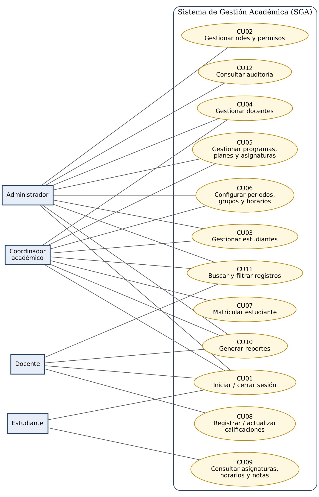
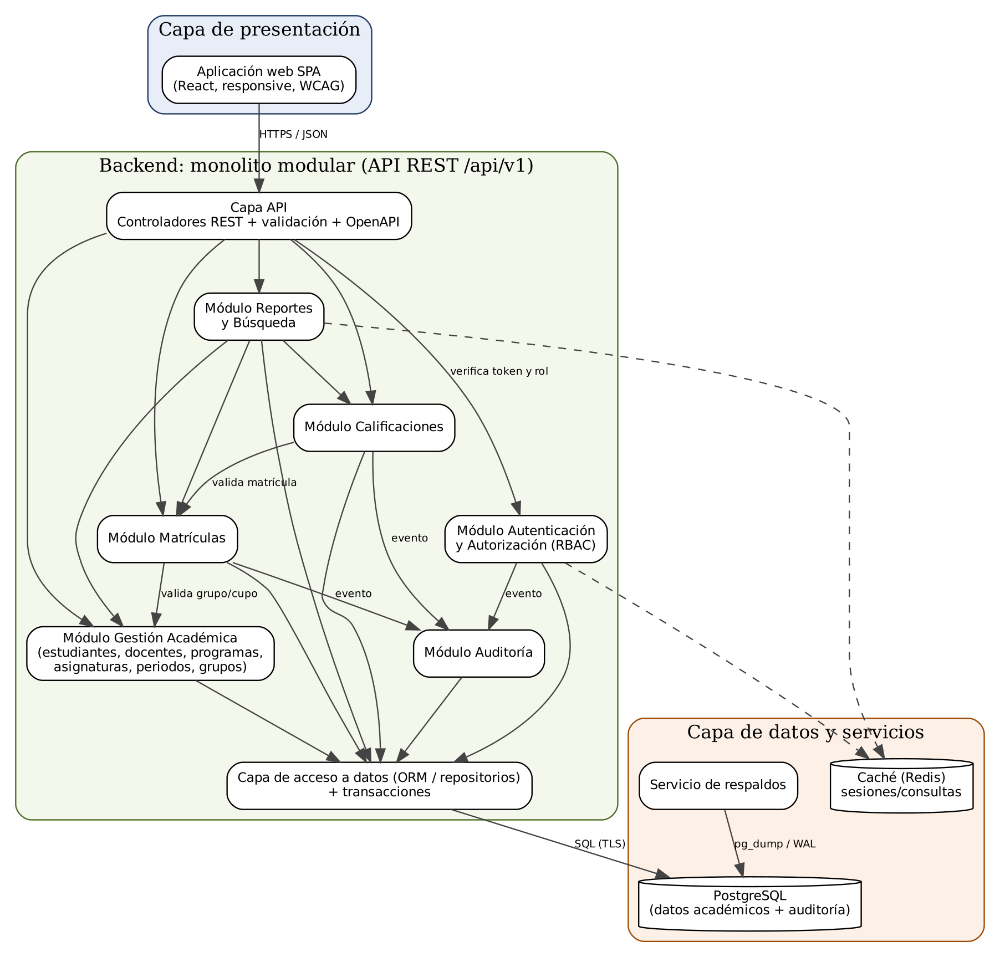
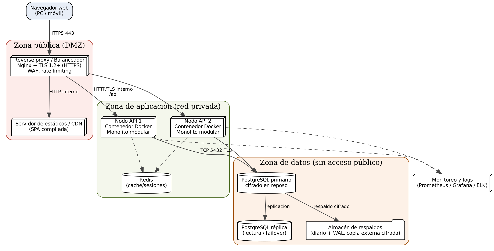
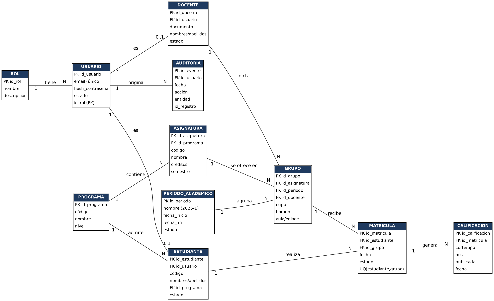
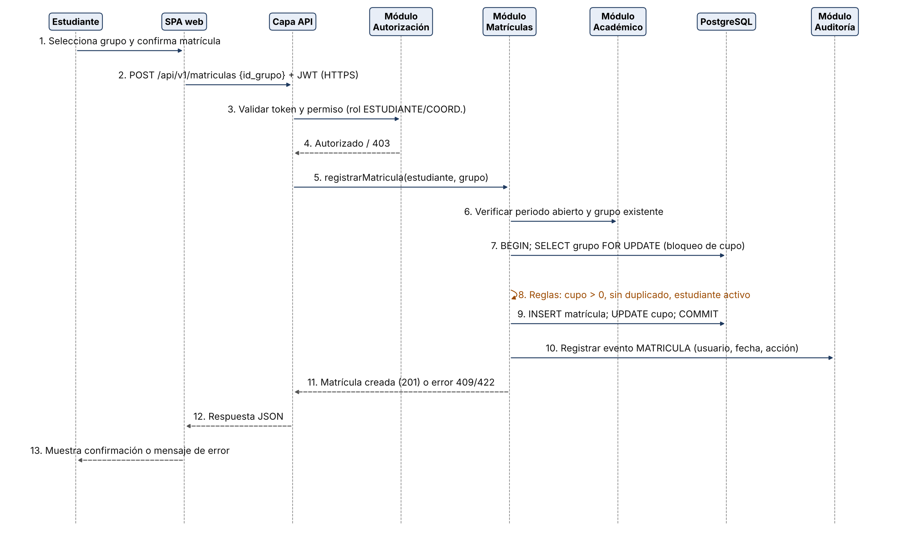
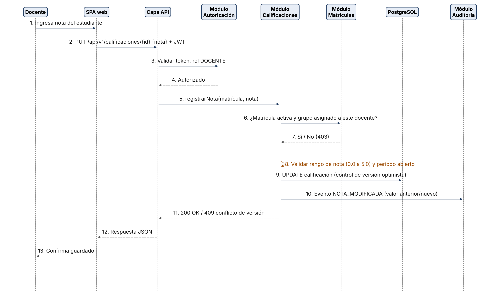

# Arquitectura de Software: Sistema de Gestión Académica (SGA)

Diseño y modelado de la arquitectura de un Sistema de Gestión Académica web, desarrollado con apoyo crítico de Google AI Studio.

| | |
|---|---|
| **Asignatura** | Arquitectura de Software |
| **Institución** | Corporación Unificada Nacional de Educación Superior (CUN) |
| **Docente** | [Nombre del docente] |
| **Integrantes** | [Nombre 1], [Nombre 2], [Nombre 3], [Nombre 4], [Nombre 5] |
| **Fecha** | [dd/mm/aaaa] |
| **Video / pitch** | [Enlace de YouTube] |

## Resumen

El SGA centraliza la información de estudiantes, docentes, programas, asignaturas, grupos, matrículas, calificaciones y horarios. La arquitectura propuesta es un **monolito modular en capas**, con **API REST** y una **SPA** como interfaz web.

- **Módulos:** Autenticación y Autorización (RBAC), Gestión Académica, Matrículas, Calificaciones, Reportes y Búsqueda, Auditoría.
- **Datos:** PostgreSQL con réplica, caché Redis y respaldos con archivado WAL.
- **Despliegue:** proxy inverso con TLS, dos nodos de API sin estado, base de datos en red privada.
- **Por qué monolito modular:** el dominio es acotado, el equipo es pequeño, la carga de referencia es de 300 usuarios concurrentes y matrícula y notas requieren transacciones ACID.

## Contenido del repositorio

| Carpeta | Contenido |
|---|---|
| `informe/` | Informe final en PDF (entrega principal). |
| `diagramas/exportados/` | Diagramas en PNG: casos de uso, componentes, despliegue, datos conceptual y dos secuencias. |
| `diagramas/fuente/` | Archivos fuente (`.dot` de Graphviz) y script que los genera. |
| `evidencias-ia/` | Prompts usados en Google AI Studio y sus capturas. |
| `docs/` | Requerimientos, matriz de trazabilidad y decisiones arquitectónicas en Markdown. |

## Diagramas

## Estado del trabajo

Este repositorio documenta una **propuesta de arquitectura**. Las cifras de rendimiento, disponibilidad y recuperación son objetivos de diseño, no resultados medidos.

| Capacidad | Estado |
|---|---|
| Análisis de requerimientos y modelos | Propuesto y documentado |
| Prototipo funcional | [Completar] |
| Pruebas de carga, seguridad y restauración | [Completar] |

## Regenerar los diagramas

Requiere Graphviz y Python 3 con matplotlib. Desde `diagramas/fuente/`: `python3 generar_diagramas.py` (crea una carpeta `img/` con los PNG).

## Nota sobre datos

No se incluyen datos personales reales ni credenciales. Todos los ejemplos son ficticios.
